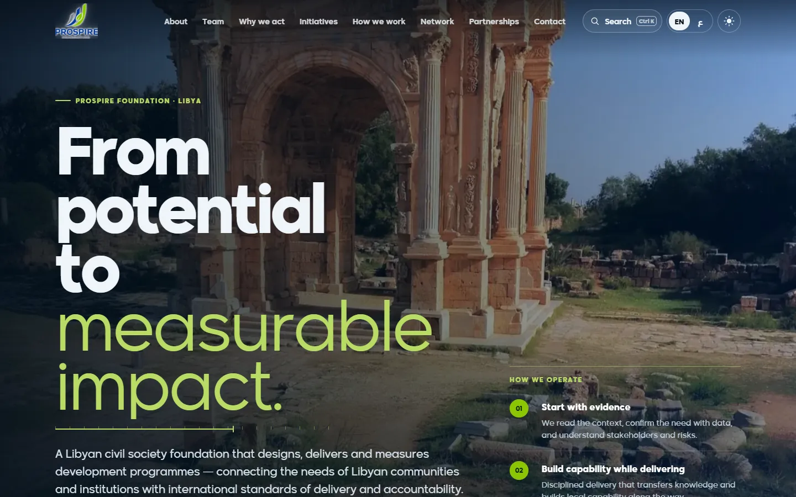
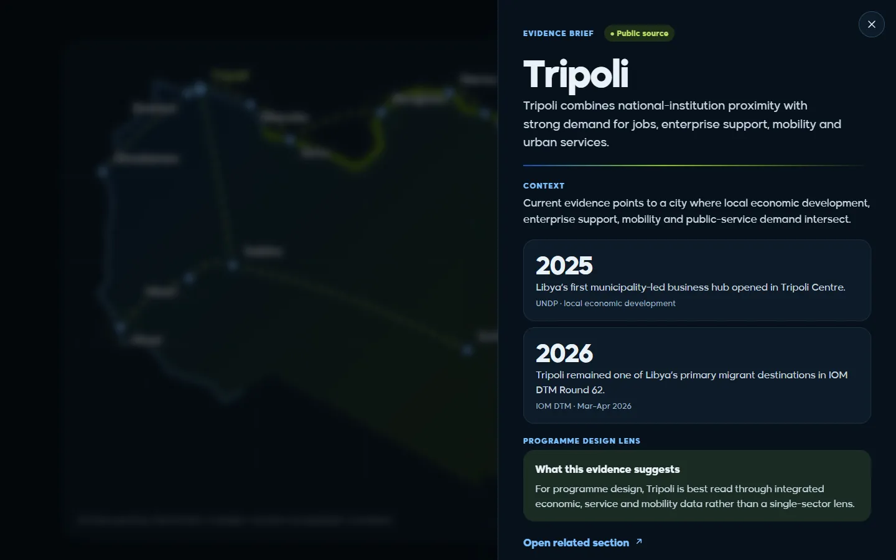
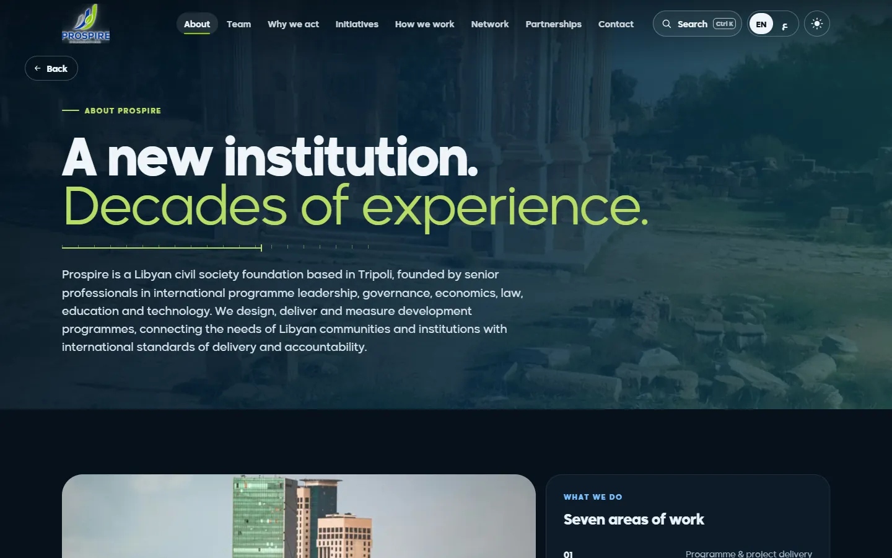

# Prospire Foundation website

Bilingual website for Prospire Foundation, a Libyan civil society foundation that designs, delivers and measures development programmes.

**Live site:** https://israairtirt.github.io/prospire-website/

| | |
|---|---|
| Client | Prospire Foundation, Libya |
| Views | Home, About, Team, Why we act, Initiatives (Mahira, Beati, Mashroui), How we work, Network, Partnerships, Contact |
| Languages | English and Arabic, right to left |
| Built with | HTML, CSS and JavaScript, no framework and no build step |

## What I built

- A single-page site with hash routing across twelve views, each with its own title, and deep links that survive a refresh.
- English and Arabic side by side in the markup, with the language, direction and theme set before the first paint so nothing flickers.
- Light and dark themes, a Ctrl+K command palette that searches pages, people and places, and an interactive map of the foundation's network across Libya.
- A motion system (word-split headings, count-ups, reveals) that respects reduced-motion settings.
- Content (people, initiatives, evidence briefs) kept in data files, apart from the app code.

## About this repository

This repository holds the published build that GitHub Pages serves: minified HTML and CSS, and minified, obfuscated JavaScript. The source code is private.

Designed and built by [Israa Tarbaghia](https://israairtirt.github.io/).
